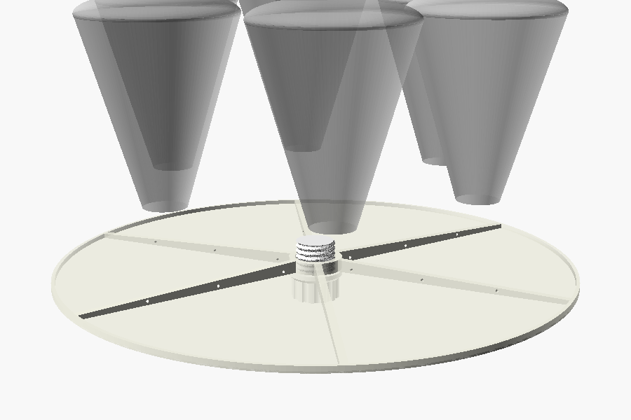
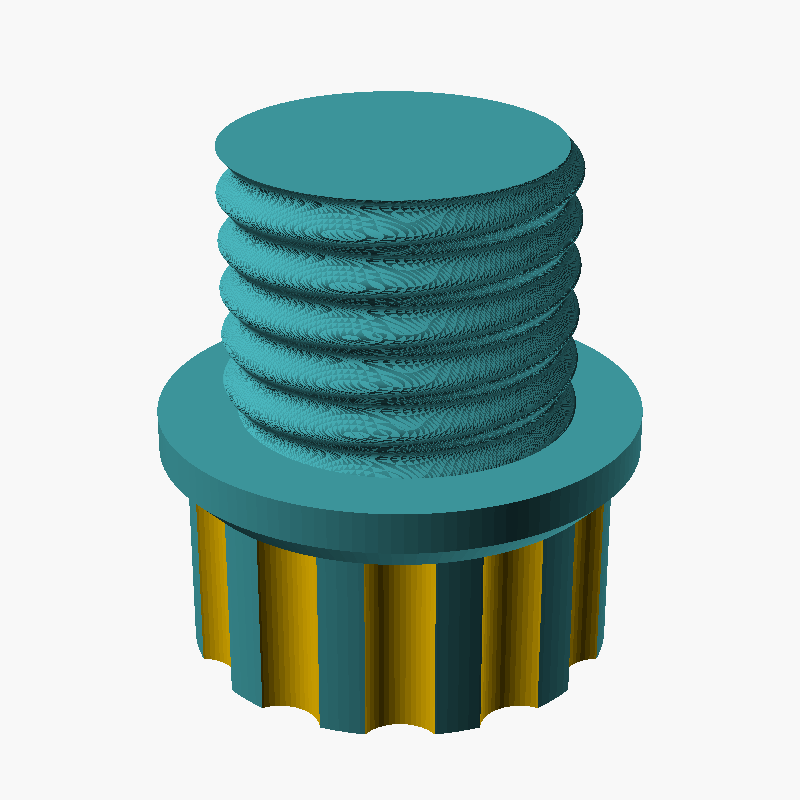
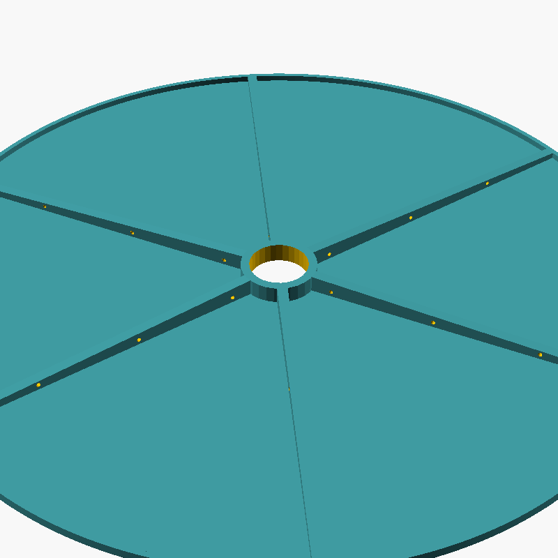
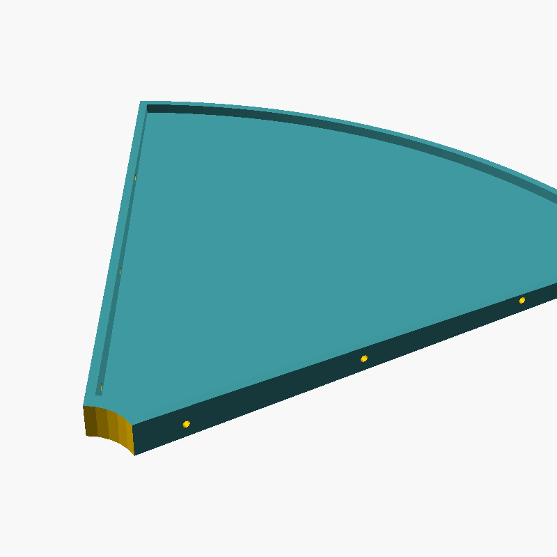
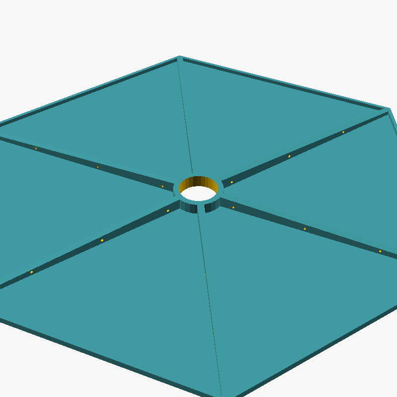
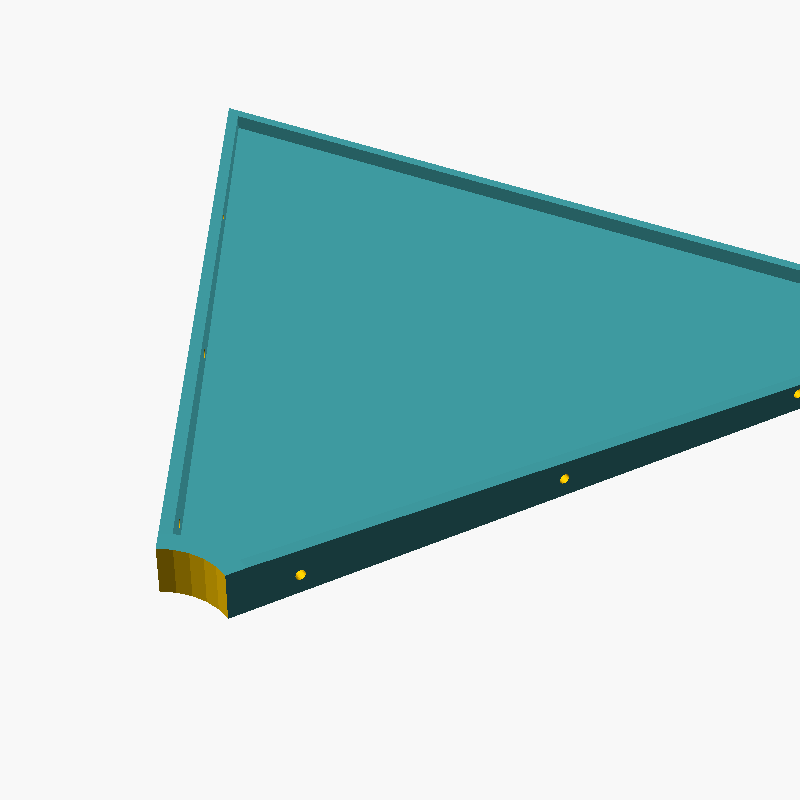
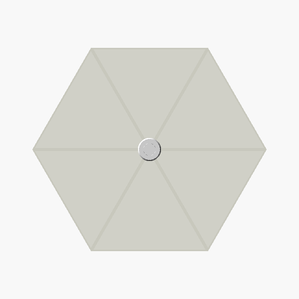
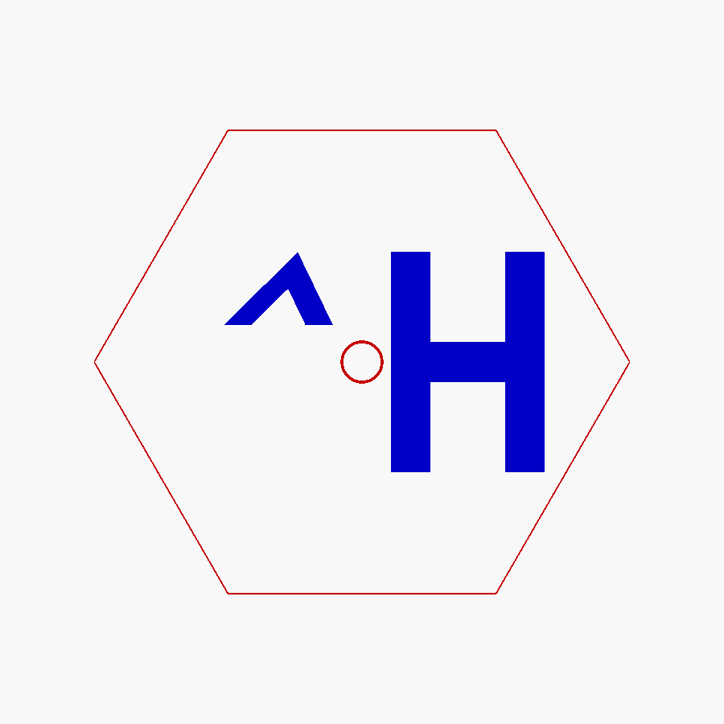
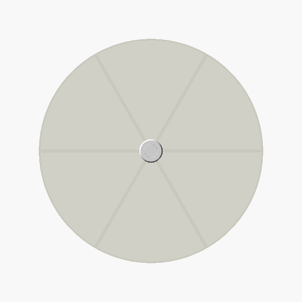

# E27 Pendant Light Diffuser

[](https://github.com/romkey/light-diffuser/actions/workflows/build-stl.yml)
[](https://github.com/romkey/light-diffuser/actions/workflows/ci.yml)
[](https://openscad.org)

A simple 3D-printable light diffuser for a hanging pendant with a
[DiCUNO 7-in-1 socket splitter](https://www.amazon.com/s?k=DiCUNO+7+in+1+socket+splitter).
The splitter's six gooseneck arms are bent so six BR30 bulbs point up. The
plug screws into the splitter's centre socket, which points down. The disc
hangs below, hiding the bulbs and bouncing their light off the ceiling.



## Parts

| Part | Source | STL |
|------|--------|-----|
| E27 threaded plug | [`src/e27_plug.scad`](src/e27_plug.scad) | [`stl/e27_plug.stl`](stl/e27_plug.stl) |
| Diffuser disc segment (print 6) | [`src/diffuser_segment.scad`](src/diffuser_segment.scad) | [`stl/diffuser_segment.stl`](stl/diffuser_segment.stl) |
| Diffuser disc, one piece (large printers only) | [`src/diffuser_disc.scad`](src/diffuser_disc.scad) | [`stl/diffuser_disc.stl`](stl/diffuser_disc.stl) |
| Hexagonal diffuser segment (print 6) | [`src/diffuser_hex_segment.scad`](src/diffuser_hex_segment.scad) | [`stl/diffuser_hex_segment.stl`](stl/diffuser_hex_segment.stl) |
| Hexagonal diffuser, one piece (large printers only) | [`src/diffuser_hex.scad`](src/diffuser_hex.scad) | [`stl/diffuser_hex.stl`](stl/diffuser_hex.stl) |
| Hexagonal diffuser, flat, for laser cutting | [`src/diffuser_hex_laser.scad`](src/diffuser_hex_laser.scad) | [`dxf/diffuser_hex_laser.dxf`](dxf/diffuser_hex_laser.dxf) (DXF) |

Print the plug plus **one** diffuser: round or hexagonal.

Shared dimensions live in [`src/params.scad`](src/params.scad), so the disc's
hole always matches the plug. Both diffuser shapes are built by
[`src/diffuser_lib.scad`](src/diffuser_lib.scad).
[`src/assembly.scad`](src/assembly.scad) shows the parts together and is only for
previewing. Set its `shape` variable to `"circle"` or `"hex"`.

### 1. E27 threaded plug



From the end that goes into the socket first:

1. **Flat end**, with a short lead-in chamfer so the thread starts easily
2. **E27 thread**: round Edison profile, 1/7" pitch (3.629 mm), right-handed
3. **Collar**: the ledge the disc sits on
4. **Grip**: fluted, for screwing and unscrewing by hand

The plug is hollow by default to save material.

<br clear="right">

### 2. Diffuser disc



A thin (1.2 mm) disc with six tapered ribs on one side for stiffness, plus a
reinforcing ring at the hub and rim. The centre hole clears the thread but is
smaller than the collar.

The disc size comes from the bulbs:

```
disc_d = 2 × (bulb_ring_r + br30_d / 2 + cover_margin)
       = 2 × (110 + 47.6 + 15) ≈ 345 mm
```

That's too big for most printers, so by default it prints as **six identical
60° wedges** of about 173 × 173 mm. The seams run along the ribs: each wedge
has half a rib on each edge, and the two halves glue together into one 4.8 mm
rib. Three 1.95 mm holes go through each seam rib, so short pieces of 1.75 mm
filament can act as alignment pins.



<br clear="right">

### 2b. Hexagonal diffuser (alternative)



The same construction as the disc (thickness, ribs, hub, rim and pinned seams),
but hexagonal. Its corners point at the bulbs, with a rib running out to each
corner, so it hides them with less plastic than a circle would. The hexagon is
sized so that each bulb, plus `cover_margin`, fits inside the two edges beside
its corner:

```
hex_apothem = bulb_ring_r × cos 30° + br30_d / 2 + cover_margin ≈ 316 mm across flats
hex_r       = hex_apothem / cos 30°                             ≈ 365 mm across corners
```

The six wedges are equilateral triangles with 182 mm sides.

<br clear="right">




When you install it, turn the hexagon so that each corner lines up with a bulb.

### 2c. Laser-cut hexagon (alternative)



A flat version of the hexagon for cutting from sheet (e.g. frosted acrylic):
just the outline and the centre hole, with no ribs or rim. It's the same size
as the printed hexagon, about 365 × 316 mm, so check it fits your laser bed.

It also has a large **^H**, centred around the hole, to engrave rather than cut, with the caret
italicised so its point leans toward the H. The DXF has two layers:

| Layer | Colour | Contents |
|-------|--------|----------|
| `CUT` | red | Hexagon outline and centre hole |
| `ENGRAVE` | blue | The ^H, as closed outlines to fill-engrave |

Set the `ENGRAVE` layer to a fill/scan operation in your laser software and run
it before `CUT`. The ^H is centred, with the hole in the space between the caret and the H.
Sizes and spacing are `text_h` (the H), `caret_h` and `hole_gap` in
[`src/diffuser_hex_laser.scad`](src/diffuser_hex_laser.scad). The design is
seen from the engraved side, so engrave the side that will face down if you
want it readable from below.

<br clear="right">

## Fitting it to your splitter

The goosenecks bend, so the bulb positions depend on how you've bent them.
Before you print, set up the splitter with the bulbs and measure from the
splitter's centre axis to the centre of a bulb's face. Set that as
`bulb_ring_r` in [`src/params.scad`](src/params.scad). Six BR30s (95.25 mm
across) touch at 95.25 mm, so the practical minimum is about 100 mm.

| Parameter | Default | Meaning |
|-----------|---------|---------|
| `bulb_ring_r` | `110` | Distance from the axis to each bulb's centre |
| `br30_d` | `95.25` | Bulb face diameter (BR30 = 3.75") |
| `cover_margin` | `15` | Extra disc past the bulbs' outer edge, to hide them from an angle |

## Assembly

The lamp hangs with the splitter's centre socket facing down.

1. Glue the six wedges (round or hexagonal) together. Push filament pins through the seam ribs,
   trim them flush, and glue the rib faces with CA glue (or a solvent weld for
   PETG/ABS).
2. Pass the plug's thread up through the disc's hole, with the ribs facing up
   toward the bulbs.
3. Screw the plug up into the splitter's centre socket using the grip.
4. The disc rests on the collar, held there by gravity.

From directly below, the bulbs are completely hidden:



## Printing

| Part | Orientation | Supports | Notes |
|------|-------------|----------|-------|
| Plug | Grip on the bed, thread up | None | The collar's underside is a 45° chamfer. A 0.2 mm layer height or finer gives a smoother thread. |
| Disc or hexagon segment | Flat side on the bed, ribs up | None | Use a translucent or white filament. PETG holds up to heat better than PLA. |

> **Heat:** use only LED bulbs and keep the disc away from hot surfaces. PLA
> softens at about 55 °C.

## Customising

Edit [`src/params.scad`](src/params.scad), or open a part in OpenSCAD and use
the Customizer. Useful parameters:

| Parameter | Default | Meaning |
|-----------|---------|---------|
| `thread_clearance` | `0.3` | Reduces the thread diameter. Increase it if the plug binds, decrease it if it's loose. |
| `thread_length` | `20` | Length of the threaded section |
| `collar_d` | `36` | Collar diameter (the ledge the disc rests on) |
| `disc_d` | computed | Disc diameter. It's derived from the bulb settings, but you can override it. |
| `disc_t` | `1.2` | Disc thickness |
| `spokes` | `6` | Number of ribs |
| `segments` | `6` | Number of wedges to print. It must divide evenly into `spokes`; `1` prints a single piece. |
| `bed_size` | `220` | Rendering a segment prints a warning if it won't fit a bed this size |
| `disc_hole_clearance` | `1.0` | Extra diameter of the hole beyond the thread |

## Building

You need [OpenSCAD](https://openscad.org) (a recent development snapshot is much
faster because it uses the Manifold backend) and `make`.

```bash
make
```

That writes the STLs to `stl/` and the laser DXF to `dxf/`. To also render the assembly as a check:

```bash
make check
```

On macOS, if `openscad` isn't on your `PATH`:

```bash
make OPENSCAD=/Applications/OpenSCAD.app/Contents/MacOS/OpenSCAD
```

## Continuous integration

- **OpenSCAD CI** (`.github/workflows/ci.yml`) renders every model on each push
  and pull request, treating warnings as errors, and uploads the STLs as a build
  artifact.
- **Build STL files** (`.github/workflows/build-stl.yml`) rebuilds the STLs
  and DXF whenever `src/` changes on `main` and commits them to `stl/` and `dxf/`.

## AI disclosure

This project was created by AI ([Claude Code](https://claude.com/claude-code))
under human guidance. The OpenSCAD models, build scripts and documentation were
generated by AI, with a human directing the design and requirements.
